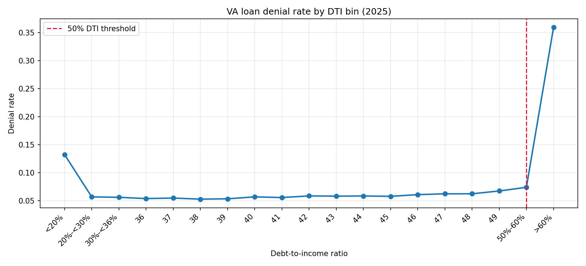
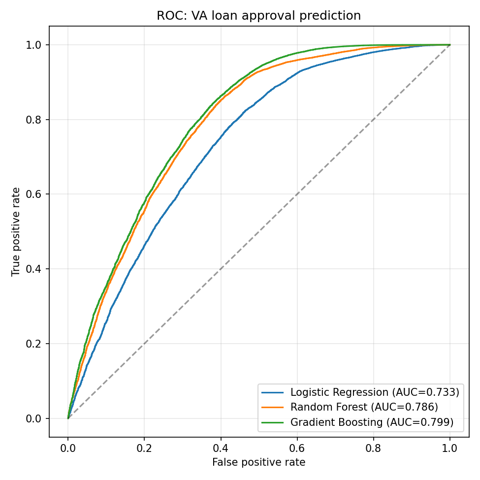
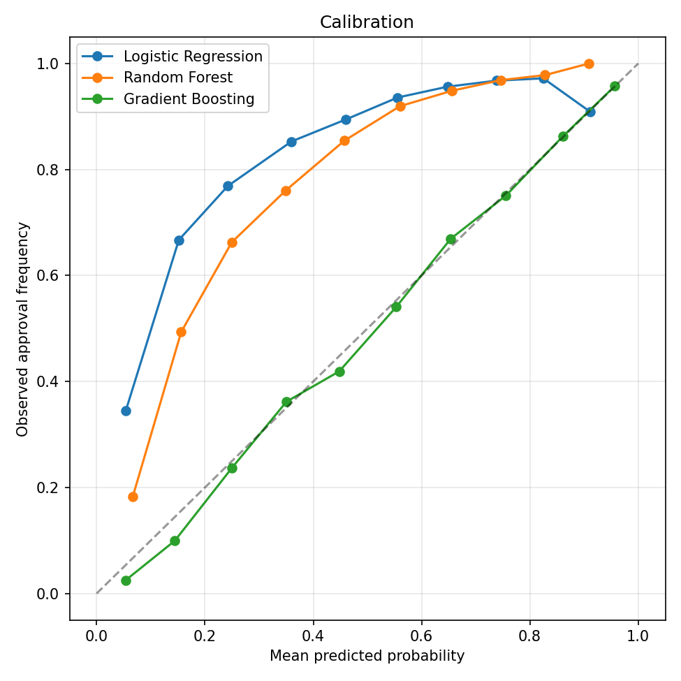
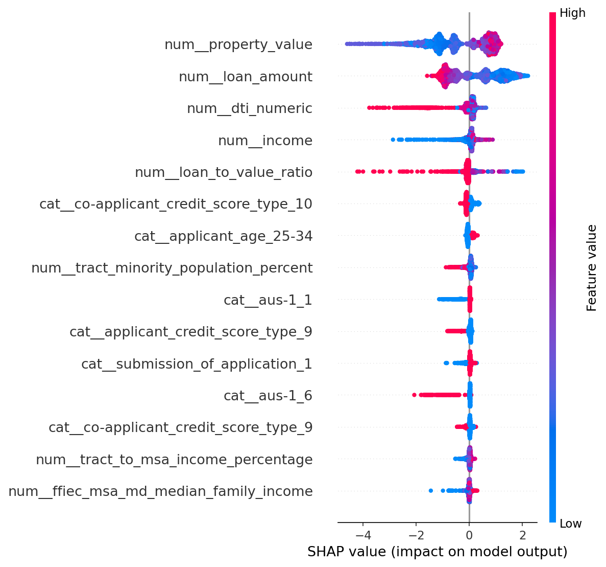
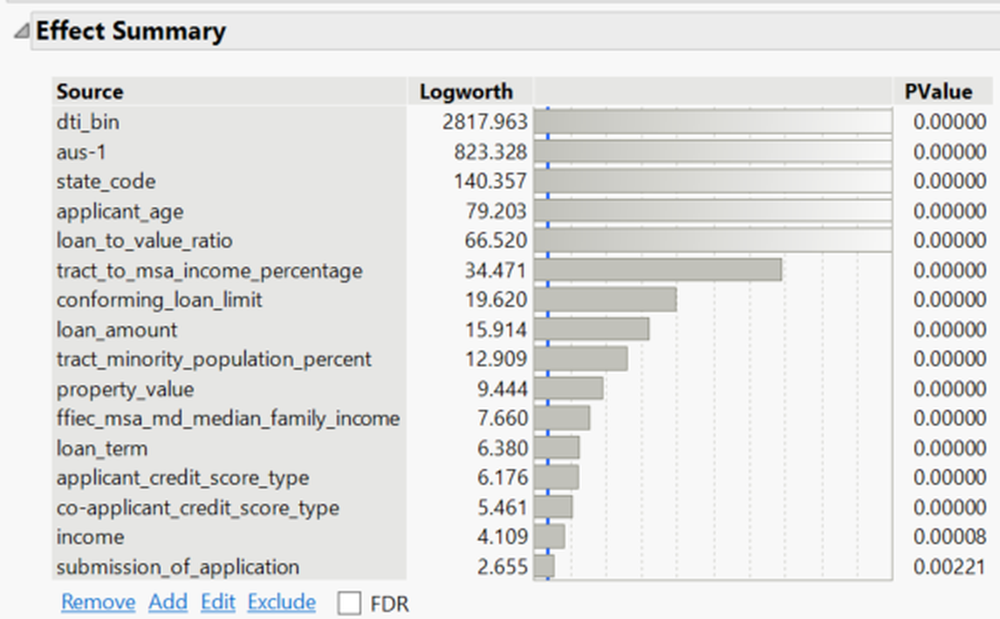
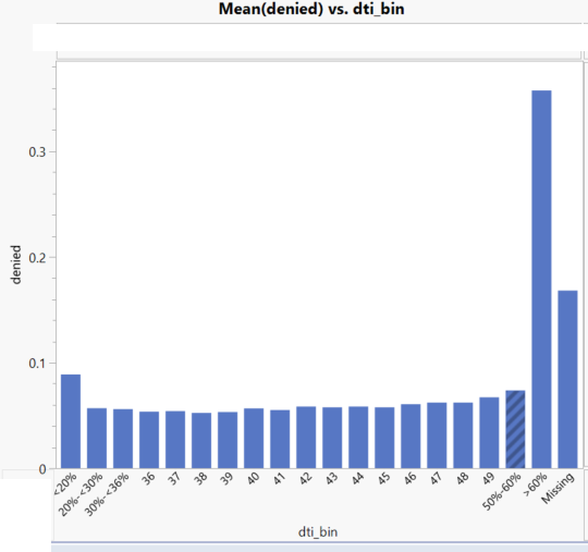

# Predicting VA Loan Approval Outcomes: ML Classification and Fairness Analysis

**M.S. Data Science Capstone (DSCI 7000), Hawaii Pacific University, 2026**
D'Andre Burdin | Army Signal Corps veteran | VA lending specialist

Using **339,211 VA-guaranteed home purchase applications** from the 2025 national HMDA dataset, this project asks four questions:

1. **What actually drives VA loan approval decisions?**
2. **Do nonlinear models beat a linear baseline, and what patterns explain the difference?**
3. **Do models treat demographic groups differently, and how much of any gap do underwriting factors explain?**
4. **Does the Hawaii market follow national patterns?**

**[View the presentation slides](docs/capstone_presentation.pdf)** | **[Read the full report](docs/capstone_report.pdf)**

## Key findings

| | |
|---|---|
| **Best model** | Gradient boosting, AUC **0.799** vs. 0.733 logistic baseline |
| **VA lending breaks the 50% DTI rule** | Denial rate rises only **0.7 pts** at 50% DTI (vs. a sharp jump in conventional lending) but **28.5 pts** above 60% |
| **Low DTI is not safe** | Applicants under 20% DTI are denied **more often** (13.2%) than those at 20 to 30% (5.7%) |
| **Fairness decomposition** | Underwriting factors explain **46.1%** of the Black/White approval gap, **56.8%** of the Hispanic gap, and **66.2%** of the female/male gap |
| **Cross-tool verification** | All results independently replicated in JMP Pro; no coefficient changed sign |



**Why it matters:** VA underwriting runs on residual income, not a hard DTI cap, so risk models and fairness audits built for conventional lending can misread VA data. Unexplained residual gaps remain for every group, but they **do not establish discrimination**: the public HMDA file omits credit score, the single most important underwriting variable.

## Methodology

**1. Population screening** (617,940 raw records to 339,211)
First lien, principal residence, site-built, single family, personal purpose, lender decision only (originated, approved not accepted, or denied). Full audit trail in [`outputs/screening_summary.csv`](outputs/screening_summary.csv).

**2. Target leakage control**
Fourteen fields were excluded because they are determined *after* or *by* the lending decision (interest rate, loan costs, denial reasons, purchaser type, HOEPA status, and others). For example, `hoepa_status` alone hits a univariate AUC of 0.987 because its "not applicable" code is only assigned to loans that were never made. Including these produces near-perfect accuracy that means nothing.

Preapproval requests were also removed: denied preapprovals are coded `action_taken = 7`, which would leave an approval-only subgroup and perfect separation.

**3. Modeling**
Logistic regression (baseline), random forest, and histogram gradient boosting in scikit-learn pipelines with median imputation, scaling, and one-hot encoding. Stratified 75/25 split. Evaluated on AUC, F1, Brier score, accuracy, and calibration.

**4. Interpretability**
Logistic odds ratios plus SHAP values on the best model. Property value, loan amount, DTI, income, and LTV dominate.

**5. Two-stage fairness analysis**
Protected attributes (race, ethnicity, sex) are **never model inputs**; they are used only for evaluation.
- *Stage 1, measurement:* demographic parity, equal opportunity, equalized odds, and calibration error by group, at a Youden-optimal threshold (a 0.50 cutoff approves 97% of applicants given the 92% base rate, which hides error rates).
- *Stage 2, decomposition:* each raw approval gap is split into the portion predicted by underwriting variables alone and the unexplained residual.

## Results

| Model | AUC | F1 | Brier | Accuracy |
|---|---|---|---|---|
| Logistic Regression | 0.733 | 0.883 | 0.192 | 0.799 |
| Random Forest | 0.786 | 0.929 | 0.139 | 0.874 |
| **Gradient Boosting** | **0.799** | **0.967** | **0.054** | **0.937** |

<p float="left">
  
  
</p>



| Group vs. reference | Raw gap | Explained by underwriting | Residual |
|---|---|---|---|
| Black vs. White | -6.7 pts | -3.1 pts (46%) | -3.6 pts |
| Hispanic vs. Not Hispanic | -1.9 pts | -1.1 pts (57%) | -0.8 pts |
| Female vs. Male | -1.4 pts | -0.9 pts (66%) | -0.5 pts |

### Hawaii (RQ4)

The same analysis run on Hawaii, the author's home market:

| | Hawaii | National |
|---|---|---|
| Applications after screening | 2,217 | 339,211 |
| Approval rate | 92.74% | 91.84% |
| Denial jump above 60% DTI | +18.1 pts | +28.5 pts |
| Total denials | 161 | 27,694 |

The DTI pattern replicates in direction. With only 161 denials spread across 19 DTI bins and several demographic groups, group-level fairness metrics could not be estimated reliably, so Hawaii is reported as descriptive corroboration, not an independent fairness audit.

### Independent verification in JMP Pro

The logistic baseline and DTI analysis were rebuilt in JMP Pro from the identical exported dataset, so any discrepancy would reflect method rather than data. JMP ranks DTI as the strongest effect (logworth 2,817.96, more than 3x the next effect), and no parameter reversed sign between the two tools. The DTI curve has the same shape in both: elevated at the low end, flat through the middle, sharp rise above 60%.

<p float="left">
  
  
</p>

## Practical implications

- **Veterans and their agents:** VA applicants in the 50 to 60% DTI band are denied 7.37% of the time, close to the 5.76% rate at 45%. Guidance calibrated to conventional lending understates their odds.
- **Lenders and regulators:** fairness audits of VA models need underwriting controls before any disparity is interpreted.
- **Model developers:** do not assume models calibrated on conventional lending transfer to VA underwriting.
- **Researchers:** replicate with credit score data, and test whether the 60% discontinuity holds across years.

## Repository structure

```
├── src/va_analysis_2025.py     # Full pipeline: screening, modeling, SHAP, fairness
├── outputs/                    # Result tables (CSV)
│   └── figures/                # ROC, calibration, SHAP, DTI charts
├── docs/capstone_report.pdf    # Full written report
├── docs/capstone_presentation.pdf  # Final presentation slides
└── data/README.md              # How to download the HMDA source data
```

## Reproduce it

```bash
pip install -r requirements.txt
# Download the data per data/README.md, then:
python src/va_analysis_2025.py
```

## Limitations

- Public HMDA data excludes credit scores, so residual gaps are an upper bound on unexplained disparity, not evidence of discrimination.
- Cross-sectional, single year (2025).
- 20% of records are missing LTV; median imputation was used.

## Tools

Python, pandas, NumPy, scikit-learn, SHAP, matplotlib, JMP Pro

## Contact

[LinkedIn](https://www.linkedin.com/in/d-andre-burdin-m-s-d-s-82136bb7/)
